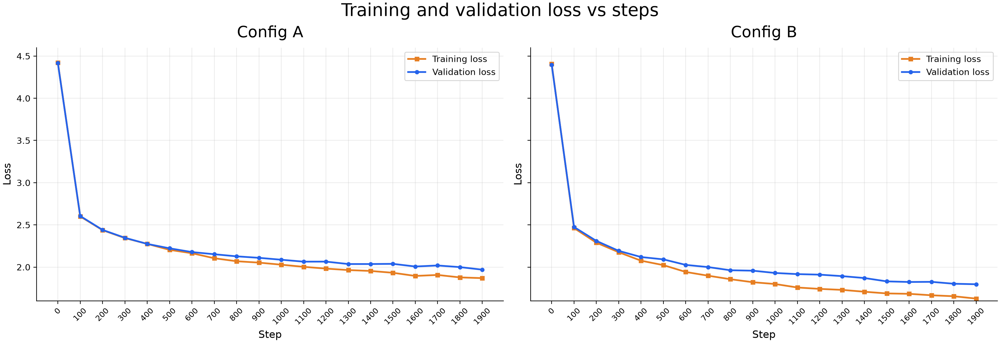
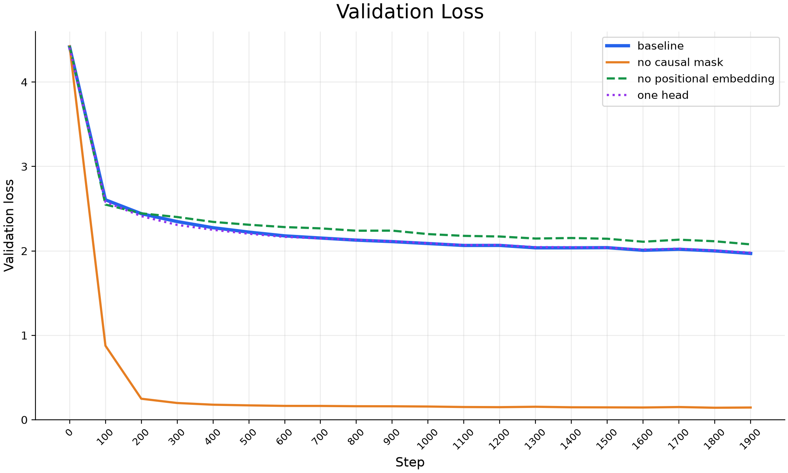
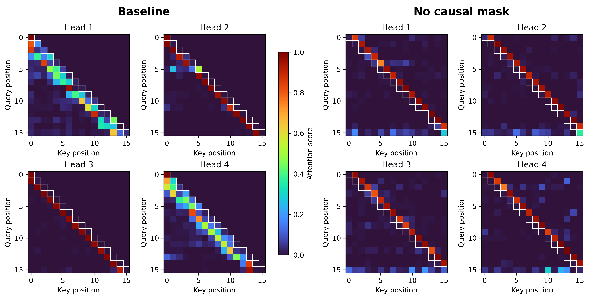

# Homework 4

## Part 1

### Device used

- GPU: 1 V100 GPU, 32GB VRAM.
- CPU: 16 core CPU, 32GB RAM.

### Loss plot



### Paremeter and runtime

| | Config A| Config B|
| --- | ---: | ---: |
| Paremeter(M) | 0.81 | 6.35 |
| Training time(s) | 92.66| 318.67 |
| Inference time(s)| 8.26 | 25.60 |

### Inference output

**Config A:**

```txt
Is tile fathere's the thear, dishall he but cker
us conmoth--York
Maphithere we have gone
The lupt tcould,
God it dity the not with plabehind.
CHAHARD IZARD II:
No machank-Here his his wife,
unor ic sue wilth my secass thee?
To to the 'elmmeny?
QUKE:
Fold Boven to my her hear she, fare an thanks a thou tatblere head dim,--
peavie the gost of her, now of him your dishalting, teasher beak shold paws notneded
sval You:
Why Dorbasy Varry my fare?
QUEENIO:
Now, hearth pake of all barcity think be lesse.
KING RICHEbe I my let freeat
charey hapt them what, carrat;
Asnd say are and held Sayou,
Thoush flather precher;
What there, but god
bittore seck vings unray
have ullibme towing deE play!
TASABELLET:
If may berow up him
That efore me here-my siling you woranflewors it I that of llow, preponer.
KING RICHARY III:
O up ere think. whan time the can den abled is me.
QUEO:
Cond he blatty there, foe, what mierth--
Combarrance the all her;! anfuber not tommqhold
More nake a all the our own To
```

**Config B:**

```txt
Whic and nust; 'Cnow one a mody are one,
Yourse,
Or I will a will pape is by we speoke.
PAAULINA:
Ic it is a kind told.
First Cowars
Mustarder.
Were you are promour: hand Hereford
First-forwul shice sents thou as gaint mee?
To too thus? my haming I hath a Bow
Or their Weless is there brone dangerains.
GLOUCESTER:
And phaseperement, mays, nor taken I mabe!
JULIET:
To that, teasurer, and then paws notned this.
Let, your Dornain Varry Angelo, but was stay?
RICHARD:
Well's all be sit unpintientless?
So upon hy ubder therefore's dectainy.
Thy do! i, whith what; sons? I war; an I do follow,
Thouse in thy pare behoman a think,
Which perit, and then in pluck acce
Pruchione obice? Ye'll shall skay but mess me his of speen comford:
Why, not, I star you so'll take mind.
MORCUSs:
I'll these speak:
I myself my lare? Sainus ere trive.
Nurse: Hath, consul, and are my bay
And trise he beathy na, would acking me? Yea,
Come, you shall are her?
KING RICHARD III:
O may, are swoes leath; on: yet if
```

### Analysis

The config b takes about 3.44x more time than config a. This is mainly becuase the increase of `n_layers` as models has to go through more layer and this process can't be parallelize. The other hyper parameter has less impact on the training time as some of the increase of the model is parallelizable and only increase the memory usage.

## Part 2

### Loss plot

*Baseline's validation loss is very close to one head's loss.*




### Final training and validation loss

| | Baseline | No causal mask | No positional embedding | One head |
| --- |  ---:|  ---: | ---:| ---: |
| Training Loss| 1.8674 | 0.1424 | 1.9856 | 1.8868 |
| Validation Loss | 1.9769| 0.1442 | 2.0697 | 1.9888 |

### Inference output

**Baseline:**

```txt
Is tile fathere's the thear, dishall he but cker
us conmoth--York
Maphithere we have gone
The lupt tcould,
God it dity the not with plabehind.

CHAHARD IZARD II:
No machank-Here his his wife,
unor ic sue wilth my secass thee?
To to the 'elmmeny?

QUKE:
Fold Boven to my her hear she, fare an thanks a
```

**No causal mask:**

```txt
d


MN

RK
BOLPOBRT:
Sad a me that doek,
Yreck puese thy go--As helap wish care hakereael
The me.

IATENT,
Ke Mich falaremang you's,
sI's thave and charl hat ghe me my han the.

BNPUSSUS:-OUS:
Oore cease worch my ary gooveeeves thorest 'klm;
Dher paich hy arB oun!-
Seroit dery is O, rear the dowessa
```

**No postitional embedding:**

```txt
ISO: as fater;
't thou duared it and he but cknourse the go--with
Lapinist.

KITHONG CERIO:
Netuke Icourn, dedeverd that mange with posbrothangs.
As murl hath pront mach notle.

LANIUS:
A-verwul reve sue winck myourgess thee? word mett;
All; hyere and a wouls old!-

Who Whowhy Reco, leve an thand sa
```

**One head:**

```txt
Whic as fathery here on upon dithanks, yep:
That
use them, and be lapionstry we saker,
Romen, lupother you, ad it dithereman, you. Mystorliar.

CHARD I'll and we me magar;
Pleathen doier with unor ic sue wilth my seequs-verevend to ontuselm; hyming I havell Bow:
No, my do destlester that an than bea
```

### Analysis

1. When having no mask, the current token can forseen the future token, which makes it predict getter by attend more to the next token, thus it can make fewer mistake and have a lower loss. However, during the inference, we the model can't see the next token, it will be struggled at prediction. This is shown on the inference result of the unmaksed, as it's generated text has lower quality than the masked baseline.
2. Without postional embedding, the model does not have the position information, so the model would mess up with the word order which affects the performance. The output's punctuation is messed up (such as the `'t` in the beginning or the `!-` in the end are examples of this) can show how the positional embedding influnce the model's performance.
3. With multiple heads, each embedding is sliced to different heads and go through separate attention and then concatenate together. This will allow model to learn the context in different aspect and thus allows model to better capture the context. Having multiple heads will potentially increase the model's generateion quality.

## Part 3

### Attention plot

*The cells on the diagonal are marked with white border.*



### Analysis

1. With masked attention, the model can only look to the current token or the previous tokens as the plot has shown that all the attention scores on the right of the diagonal is 0. The plot also shows how most token has higher attention score to itself or the previous tokens. For example, in head 1, the cells below the diagnoal has higher score, which is the previous 2-3 token and the cell before also has some attention. Also the the attention score is always 1 for the first token since itself is the only token that it can attend.
2. Without mask, the model will only rely on the next token so that each token will have a high score to the next one as shown in the graph. It also shows that the part on the left of the diagnoal is not zero, which means that the model can see the future token. This explains why the loss is low: the model simply only look at the next token and copy the next token which will make the prediction same as the actual result, resulting in a lower loss.

